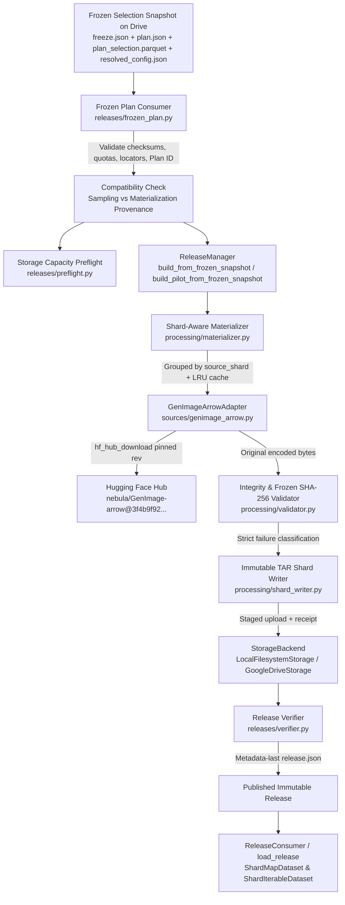

# ProofLens — Scalable GenImage Data Pipeline Guide

This guide documents the production dataset engineering pipeline inside `src/prooflens/data/`, including **Phase 2: Production Arrow Integration & Frozen Plan Materialization** for the verified sharded Apache Arrow source (`nebula/GenImage-arrow`).

---

## 1. Why a Dedicated Arrow Adapter Was Required

The Phase 1 pipeline supported extracted directory trees (`DirectoryGenImageAdapter`), ZIP/TAR archives (`ArchiveSourceAdapter`), and generic Hugging Face `datasets` streaming (`HuggingFaceGenImageAdapter`). During Colab acquisition (Cells 1–4.3), the verified upstream source was pinned to:

- **Repository:** `nebula/GenImage-arrow` (`https://huggingface.co/datasets/nebula/GenImage-arrow`)
- **Pinned Revision:** `3f4b9f921a673be09a93b335ed728cea0c6ecf33`
- **Canonical Source ID:** `genimage_arrow_sharded`
- **Structure:** 16 partitions across `data/{train,test}/{ADM,BigGAN,glide,Midjourney,stable_diffusion_v_1_4,stable_diffusion_v_1_5,VQDM,wukong}/data-XXXXX-of-YYYYY.arrow` (1,362 total Arrow shards; 76 shards cover the frozen 120,000-image selection).

The generic `HuggingFaceGenImageAdapter` was insufficient because:
1. It relied on `datasets.load_dataset(..., streaming=True)` which traverses unrelated partitions rather than downloading only the 76 required Arrow shards.
2. Train and test Arrow shards have **different schemas** (train includes optional `md5`, `width`, `height`; test contains `image_path`, `image`, `label`, `generator`).
3. The `image` column stores raw encoded image `binary` bytes directly rather than decoded PIL images or HF Image dicts.
4. Upstream `generator` is an `int64` column and must NEVER be blindly converted to strings; canonical generator provenance comes from the validated partition directory mapping (`ADM -> adm`, `BigGAN -> biggan`, `glide -> glide`, `Midjourney -> midjourney`, `stable_diffusion_v_1_4 -> sdv4`, `stable_diffusion_v_1_5 -> sdv5`, `VQDM -> vqdm`, `wukong -> wukong`), with `generator="none"` for `REAL` (`0`) images.
5. Frozen selections use exact Arrow locators (`source_shard`, `source_row_index`, `original_image_path`, `source_path`) that must be preserved verbatim alongside frozen SHA-256 hashes without re-sampling.

---

## 2. Architecture & Data Flow (Phase 2)



---

## 3. Canonical Contracts & Source Locator Compatibility

### Arrow Source Schema Contract
- **Mandatory columns:** `image_path` (`string`/`large_string`), `image` (`binary`/`large_binary`), `label` (`int` in `{0, 1}`).
- **Optional columns:** `md5`, `width`, `height`, `generator`.
- Both Arrow IPC File (`pyarrow.ipc.open_file`, magic `ARROW1`) and Arrow IPC Stream (`pyarrow.ipc.open_stream`) are read batch-by-batch without converting full tables into Pandas DataFrames.

### Canonical Source Locator Contract
```text
source_path = "{shard_filename}/rows/{row_index:08d}/{normalized_original_path}"
```
- `source_shard`: e.g., `data/train/ADM/data-00000-of-00099.arrow`
- `source_row_index`: non-negative `int64` preserved explicitly in `CANONICAL_ARROW_SCHEMA`
- `original_image_path`: normalized relative path inside the Arrow row
- `image_id`: unchanged `make_canonical_image_id(source_id, source_revision, source_path)` (`pl_<sha256[:20]>`)

### Original Image Byte Preservation
- Raw encoded bytes are read verbatim from the Arrow `image` binary column and written verbatim into uncompressed POSIX TAR members.
- Pillow decodes bytes in memory solely for integrity validation (`LOAD_TRUNCATED_IMAGES = False`), dimension/format inspection, and optional dHash/pixel-hash computation — **never** to re-encode, resize, normalize, or alter stored bytes.
- Output TAR member extensions use the actual detected image format when the original filename extension is missing or inconsistent.

---

## 4. Sampling Provenance vs. Materialization Provenance

Because switching source adapters (e.g., to `huggingface_arrow`) or tuning runtime parameters (`working_dir`, `materialization_workers`, `arrow_cache_dir`, `storage`) changes the runtime `config_hash`, ProofLens explicitly separates:

| Provenance Scope | Recorded Fields | Policy |
| :--- | :--- | :--- |
| **Sampling Provenance (Immutable)** | `sampling_plan_id`, `sampling_config_hash`, `sampling_code_commit`, `source_id`, `source_revision`, `protocol_version`, `sampling_seed`, `snapshot_location` | **Locked.** Never re-sampled, overwritten, or forged. Verified against `plan_selection.parquet` and `resolved_config.json`. |
| **Materialization Provenance (Runtime)** | `materialization_config_hash`, `materialization_code_commit`, `materialization_runtime` (Python, PyArrow, adapter type, storage backend, worker count, cache caps) | **Authorized runtime changes** allowed and recorded in `materialization_provenance.json`, `audit_summary.json`, and `release.json`. |

Any mismatch in immutable semantic fields (`source_id`, `source_revision`, `protocol_version`, `seen_generators`, `unseen_generators`, split quotas/rules, `label_mapping`, `sampling_seed`, or official `release_id`) raises `FrozenPlanCompatibilityError`.

---

## 5. Resource Management, Capacity Preflight & Resume Behavior

- **Shard-Aware Scheduling & Bounded Arrow Cache:** Output TAR shard specs sort by `(release_split, source_shard, source_row_index, image_id)`. `GenImageArrowAdapter` caches downloaded `.arrow` shards in a bounded LRU cache (`arrow_max_cached_shards`, `arrow_max_cache_bytes`) and the materializer tracks per-shard remaining reference counts, invoking `adapter.release_source_shard(shard)` as soon as no pending output TAR shards need it.
- **Read-Only Capacity Preflight (`preflight`):** Computes estimated original image bytes + TAR header/padding (~1 KiB/image) + metadata + in-flight shard retry overhead + local temporary Arrow/TAR staging disk + configurable safety margin (default 15%). When remote Google Drive quota cannot be established, reports `remote_status: "UNKNOWN"` and `overall_status: "REQUIRES_EXPLICIT_APPROVAL"`.
- **Strict Frozen Failure Classification:** Errors are classified explicitly into `SOURCE_FETCH_FAILURE`, `SOURCE_LOCATOR_MISMATCH`, `SHA256_MISMATCH`, `INVALID_IMAGE_PAYLOAD`, `IMAGE_DECODE_FAILURE`, and `STORAGE_FAILURE`. Under `strict_frozen_mode: true`, any failure logs the exact `image_id`, `source_shard`, and `source_row_index` to `exclusions.jsonl` and halts immediately without silent substitution.
- **Resume & Idempotency:** Resuming verifies remote shard `.receipt.json` (`status == "COMMITTED"`), exact member ID set, remote byte size, and remote SHA-256, and enforces a `committed_image_ids` guard so no image can ever be committed twice.

---

## 6. Near-Duplicate Audit & Quality Gate

Near-duplicate auditing has **not** yet been completed on the frozen 120,000-image dataset. During materialization, ProofLens computes 64-bit `dHash` (`perceptual_hash`) in the same decode pass and runs Multi-Index Band LSH candidate detection:
- Exact SHA-256 duplicate evidence is strictly separated from perceptual dHash similarity candidates.
- Images are **never** silently dropped based on perceptual similarity.
- `near_duplicate_quality_gate` supports `"warn"` (logs cross-split candidates in `audit_summary.json` and verification warnings) or `"block_publish"` (fails `verify` and blocks publication until an explicit versioned research decision is recorded).

---

## 7. Exact CLI Commands

```bash
# 1. Inspect available CLI commands
python -m prooflens.data.cli --help

# 2. Validate frozen snapshot integrity, checksums, quotas, locators, and config compatibility
python -m prooflens.data.cli validate-frozen \
  --config configs/releases/genimage_120k_v1_arrow.yaml \
  --expected-records 120000 \
  --expected-plan-id plan_5f4143bb761cac8c

# 3. Run read-only local + remote storage capacity preflight
python -m prooflens.data.cli preflight \
  --config configs/releases/genimage_120k_v1_arrow.yaml

# 4. Run an isolated bounded pilot (writes ONLY to scratch storage, never official releases/)
python -m prooflens.data.cli pilot \
  --config configs/releases/genimage_120k_v1_arrow.yaml \
  --sample-count 32 \
  --pilot-storage-dir /content/prooflens_pilot_scratch

# 5. Materialize full frozen selection (ONLY after pilot passes and capacity preflight is approved)
python -m prooflens.data.cli build \
  --config configs/releases/genimage_120k_v1_arrow.yaml \
  --strict-frozen \
  --resume

# 6. Verify release checksums, TAR structure, quotas, leakage, and quality gates
python -m prooflens.data.cli verify \
  --release genimage-120k-v1 \
  --storage-config configs/storage/google_drive_api.yaml \
  --verify-tar-members

# 7. Publish immutable release.json last
python -m prooflens.data.cli publish \
  --release genimage-120k-v1 \
  --storage-config configs/storage/google_drive_api.yaml

# 8. Prepare a published split into local Colab cache for CNN training
python -m prooflens.data.cli prepare \
  --release genimage-120k-v1 \
  --split train \
  --storage-config configs/storage/google_drive_api.yaml \
  --cache-dir /content/prooflens_cache
```

---

## 8. Future Scaling Compatibility (120K → 200K → 500K+)

The frozen evaluation splits (`dev`, `seen_test`, `unseen_test`) and committed TAR shards from `genimage-120k-v1` remain immutable and reusable as `parent_release_id` for future nested expansions (`genimage-200k-v1`, `genimage-500k-v1`). The frozen snapshot consumer never hardcodes `120,000` and supports any validated release size.

---

## 9. Testing & Known Cloud Limitations

- **Default offline test suite (CPU-only, synthetic Arrow IPC file + stream fixtures, zero network/credentials):**
  ```bash
  python -m pytest -q
  ```
- **Opt-in bounded real Hugging Face Arrow test (Colab only):**
  ```bash
  export PROOFLENS_REAL_HF_ARROW_TEST=1
  python -m pytest tests/data/test_genimage_arrow_and_frozen_plan.py -k test_real_hf_arrow_opt_in -s
  ```
- **Unverified locally:** Real Hugging Face Hub rate limits/download throughput, real Google Drive shared folder (`1IipfeWX_OVJS2KwaFL5wFlO-edxLoEGD`) quota/upload stability on 24+ GiB of shards, and real 120K near-duplicate audit results must be verified in Colab starting with the bounded pilot.
